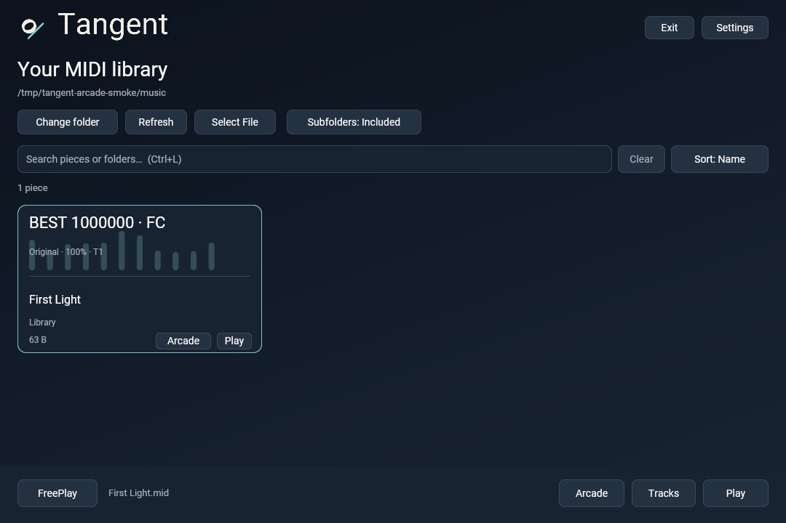
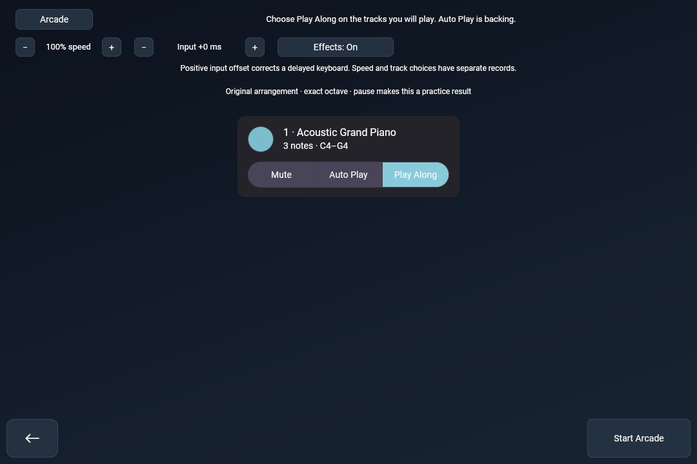
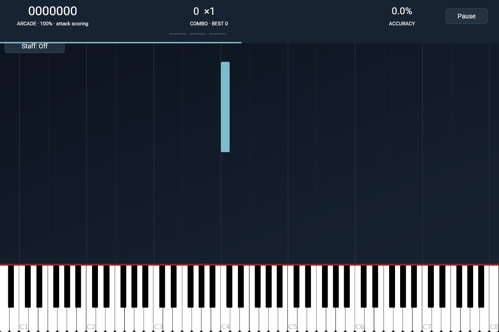
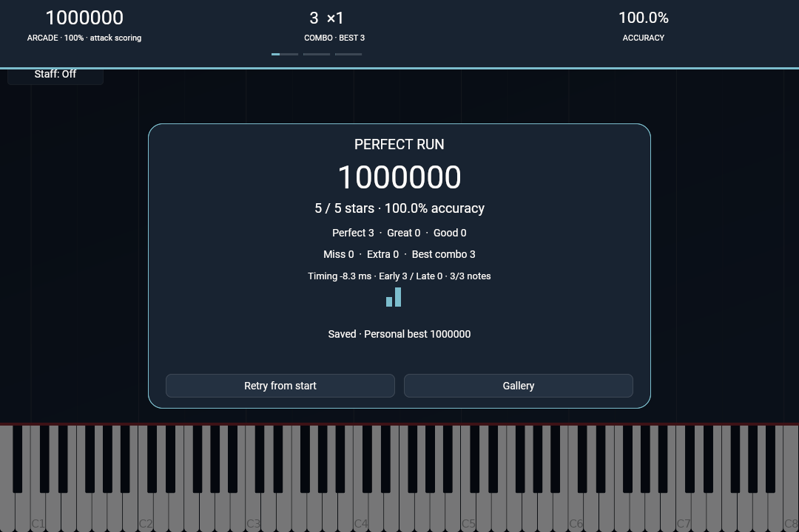

# Tangent: pianoøving med litt mer spillfølelse

23. oktober 2026

Tangent har fått sin første spillbare Arcade-modus. Velg en MIDI-fil, bestem hvilke stemmer du skal spille, og prøv å slå din egen rekord. Notene fortsetter selv om du bommer. Du må finne tilbake til rytmen og spille videre.

Utgangspunktet for denne forken var et ganske enkelt ønske: å kunne trykke på pianoet og få vite hvilken akkord jeg spiller. Derfra har det blitt både akkordtrening, notelesing, et fast MIDI-bibliotek og nå poeng. Underveis fikk løsningen navnet Tangent, med en logo som kombinerer en noteform og en linje som tangerer sirkelen.

## Et sted å begynne

Biblioteket husker mappen med MIDI-filene dine. Når du åpner appen igjen, ligger stykkene der, med søk og valgfri skanning av undermapper. Hvert kort har egne knapper for vanlig avspilling og Arcade.

*Biblioteket viser beste registrerte resultat og hvilken kategori det gjelder. «First Light» er et kort teststykke med tre noter, ikke en demonstrasjon av et helt konsertstykke. Omslaget er generert grafikk, ikke albumkunst.*

Vanlig øving er fortsatt en viktig del av appen. Du kan øve på enkeltnoter i bass- og diskantnøkkel, eller på vanlige akkorder med notene stablet på notelinjene. Øvelsene fortsetter uten en fast slutt. Referanselyd kan slås på hvis du også vil bruke ørene. Ved MIDI-avspilling kan du vise noter som ruller, eller sider med en markør som beveger seg over arket.

## Spillfølelse, med piano som utgangspunkt

Arcade henter inspirasjon fra rytmespill, men oppgaven er å spille piano: riktig tone, riktig oktav og riktig tidspunkt. Før start velger du hvilke MIDI-spor du skal spille selv. Andre spor kan være akkompagnement eller dempes. Et spor er ikke nødvendigvis en hånd eller en vanskelighetsgrad, så toneomfanget vises i oppsettet.

Du kan justere hastigheten fra 25 til 200 prosent og korrigere kjent inputforsinkelse før du begynner. Etter nedtellingen går stykket på en fast tidslinje. Treff gir umiddelbar tilbakemelding, med små ringer, gnister og pulser. Effektene kan slås av.

## Hva skal gi poeng?

Poengene skal gjøre framgang synlig. Et perfekt gjennomført stykke gir én million poeng. Det gjelder både korte og lange stykker, slik at du kan måle framgangen din på det samme arrangementet. En million på et enkelt stykke betyr likevel ikke det samme som en million på et vanskelig stykke.

| Treff | Avstand fra riktig tidspunkt | Grunnpoeng |
| --- | --- | --- |
| Perfect | Inntil 45 ms | 100 |
| Great | Over 45, inntil 90 ms | 80 |
| Good | Over 90, inntil 150 ms | 50 |
| Miss | Ingen match innenfor vinduet | 0 |

En komplett akkord øker combo én gang, mens hver tone får sine egne treffpoeng. Dermed bygger ikke en stor akkord combo flere ganger bare fordi den har mange toner. En ekstra tone koster poeng og bryter combo. Å holde en tangent eller sustainpedalen nede kan heller ikke treffe senere gjentakelser av samme tone.

Multiplikatoren øker fra ×1 til ×4 når du bygger combo. Resultatskjermen viser treffene, bommene, ekstra toner, lengste combo og om du vanligvis spiller tidlig eller sent. Akkurat nå vurderes anslagene; lengden på tonene og pedalteknikk gir ikke poeng.

Rekorder lagres lokalt og vises over omslaget i biblioteket. Hastighet og sporvalg har egne kategorier. En pause gjør gjennomspillingen til et øvingsresultat, slik at den ikke erstatter en rekord fra en sammenhengende runde.

## Neste steg

Denne versjonen bruker originalarrangementet i MIDI-filen. Egne Easy-, Medium- og Hard-arrangementer er planlagt, men finnes ikke ennå. Utgangspunktet skal fortsatt være formater som passer piano. Clone Hero er inspirasjon for spillfølelsen; dataformatet deres brukes ikke.

Skjermbildene er fra appen som kjører på Linux med programvarerendering. Den korte gjennomspillingen er testet med PC-tastaturet, inkludert lagring og gjenlasting av rekord. Windows-grensesnittet, fysisk MIDI-piano, pedal og faktisk forsinkelse trenger fortsatt praktisk testing.

Tangent bygger videre på [Neothesia av PolyMeilex](https://github.com/PolyMeilex/Neothesia). Koden og utviklingen ligger i [repoet](https://github.com/passeride/Neothesia), og [Arcade-guiden](../pages/arcade.md) beskriver reglene og innstillingene mer detaljert.
