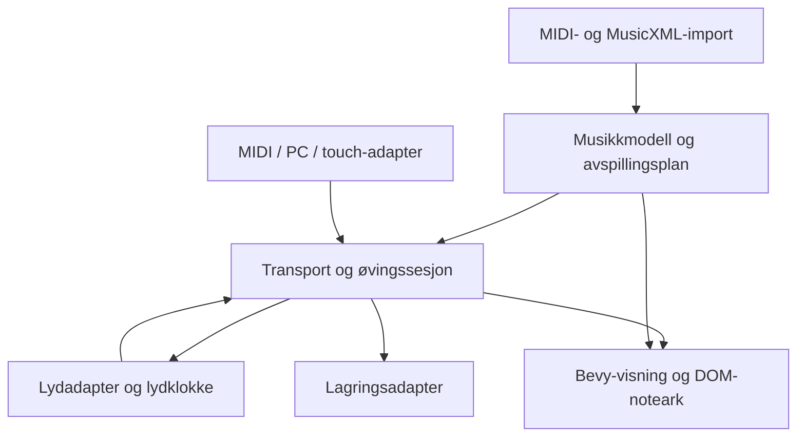

# Ny Tangent: Bevy, web og en dokumentert clean room-prosess

Dato: 24. oktober 2026. Status: **plan og teknologivurdering; ingen ny implementasjon er startet**.

Målet er en selvstendig pianoapp med Bevy og nettleser som leveransemål fra første
milepæl. Dette er et nytt prosjekt, ikke en portering av Neothesia-forken. Den gamle
forken beholdes med eksisterende lisens og historikk. Denne planen lagres her som
prosjektstyring; den er **ikke et godkjent clean room-kravgrunnlag for direkte
innmating til implementøren**.

## Anbefalt retning

- Nytt repo med ny Git-historikk og egen avhengighets-/assetoversikt.
- Bevy **0.20.0** som undersøkt utgangspunkt, med 2D og UI; versjoner låses etter en
  liten web-prototype. Ikke velg motorversjon ut fra en gammel MIDI-plugin. [B1]
- En liten Rust-kjerne uten Bevy, GPU, filer eller enheter. Bevy er presentasjon,
  inputintegrasjon og appflyt, ikke lagringsformat eller klokkeautoritet for lyd.
- Uavhengig publiserte `midly` og `midir` kan vurderes. Forkens lokale `midi-file`,
  `midi-io`, renderer, modeller, tester og øvrige kode skal ikke flyttes over.
- Web Audio for planlagt pianoavspilling; prøv RustySynth i en separat WASM-modul i
  AudioWorklet. Bevy-lyd eller Kira kan håndtere enkle UI-lyder, men er ikke i seg
  selv et ferdig system for presis piano-input og vurdering.
- Start med en lett, egen staff-visning for note-/akkordøving. Undersøk
  OpenSheetMusicDisplay som DOM/SVG-panel for fullverdige MusicXML-noteark. [N1]
- Funksjoner skal kunne prøves uten MIDI-enhet: filavspilling, PC-taster og
  skjermpiano er første fallback, ikke en feilmelding som blokkerer hele appen.

[Bibliotekvurderingen](bevy-libraries.md) har versjoner, lisensmetadata,
kompatibilitetsfunn, kilder og beslutninger.

## 1. Hva «clean room» skal bety i dette prosjektet

Et nytt språkrammeverk, nye filnavn eller en ny Git-historikk dokumenterer ikke
alene uavhengig tilblivelse. EU-direktivet om dataprogrammer skiller mellom uttrykk
og underliggende ideer/prinsipper, og nevner også forberedende designmateriale.
Det betyr ikke at alle gamle designdokumenter automatisk er frie å gjenbruke. [L1]

Prosessen nedenfor er en foreslått dokumentasjons- og separasjonsmetode, ikke en
juridisk garanti eller en avgjørelse om hvilken lisens et framtidig produkt kan ha.
Ved behov for en formell påstand om uavhengighet må prosess, eierskap og lisensvalg
vurderes særskilt. Det er ikke nok å fjerne GPL-filer eller copyrightlinjer.

### Roller og arbeidsflyt

1. **Krav-/observasjonssiden** samler brukerens selvstendige produktønsker,
   standarder, offentlig API-dokumentasjon og eventuelle lovlige observasjoner av
   programatferd. Før logg over kildene og tidligere kildekodeeksponering.
2. **Gjennomgang av overleveringen** fjerner kode, pseudokode som gjengir gammel
   implementasjon, interne strukturer, kildeavledede tester og kopierte uttrykk.
   Merk hva som er brukerkrav, standardkrav, observerbar oppførsel og nye valg.
   Dokumenter rett til å bruke selve kravdokumentet og tilhørende filer.
3. **Implementeringssiden** får bare den gjennomgåtte pakken, godkjente
   tredjepartskilder og et rent arbeidsområde. Ingen fork som submodul,
   kodeassistentkontekst, søkeindeks, vedlegg, gjenbrukte binærer eller promptarkiv.
4. **Verifikasjonssiden** tester mot selvstendig utledede forventninger og
   standarder. Avvik meldes som input/forventet resultat, ikke som gamle løsninger.
5. Endringer i kravgrunnlaget følger samme gjennomgang, med versjon og innholdshash.

Jeg som har laget denne planen har allerede arbeidet med forkens kildekode.
Denne samtalen kan derfor ikke være en kildekode-uavhengig implementeringskontekst.
En ny AI-samtale eller en annen agent er heller ikke i seg selv bevis på
uavhengighet. Bruk en dokumentert separat implementør/kontekst etter den valgte
prosessen, og vær ærlig om eksponering som faktisk har skjedd.

### Hva kan tas med?

| Materiale | Foreslått behandling |
| --- | --- |
| Brukerens ønsker om pianoøving, notelesing, bibliotek og rytmespill | Omskriv til selvstendige atferdskrav og akseptansetester i gjennomgått pakke |
| MIDI/MusicXML/Web Audio-standarder | Bruk som primærgrunnlag, med kilde og dato |
| Publiserte tredjepartsbiblioteker | Installer fra original distributør med egen lisens- og proveniensvurdering |
| Forkens lokale MIDI-bibliotek, poengmotor, UI og shaderkode | Ingen kopiering, oversetting eller flytting, heller ikke kode vi nylig skrev i forken |
| Forkens tester, snapshots og MIDI-/MusicXML-eksempler | Lag nye testtilfeller fra standarder og egne musikalske eksempler; ikke importer automatisk |
| Logo, fonter, SoundFont, MIDI-samling og omslag | Egen opprinnelses-/rettighetskontroll; bruk nye eller uavhengig lisensierte filer som standard |
| Tidligere TODO-er og ADR-er | Referanser for prosjektledelsen, ikke automatisk overlevering eller gjenbrukbar arkitekturkode |

Et bibliotek blir ikke utelukket bare fordi samme bibliotek eller forfatter også
forekommer i et annet prosjekt. Det avgjørende i denne planen er uavhengig
bibliotekopprinnelse, gjeldende lisens og at forkens wrapperkode ikke følger med.
`midly` er altså en kandidat; lokalcraten med navnet `midi-file` er ikke det.

### Dokumenter i det nye repoet

- `PROVENANCE.md`: prosess, roller, eksponering og tillatte kilder.
- `spec/`: gjennomgåtte produktkrav med ID-er og sporbarhet til kilder.
- `THIRD_PARTY.md` og assetmanifest: pakke/fil, versjon/hash, kilde, lisens og notices.
- `decisions/`: nye valg og målte resultater, skrevet selvstendig.
- Egen lisens etter eierskaps-/avhengighetsvurdering. MIT/Apache-2.0 er et mulig
  mål, ikke en relisensiering av den eksisterende GPL-forken.

## 2. Web er en plattform, ikke bare et kompilat

| Område | Web-baseline | Viktig begrensning / test |
| --- | --- | --- |
| Rendering | WASM + WebGPU, separat WebGL2-bundle som kompatibilitetsalternativ | Bevy demonstrerer begge; ikke lov automatisk bytte i ett binærbygg uten test. Ingen nødvendige compute-effekter. [B2] |
| MIDI-input/-output | Feature detection og eksplisitt tilkobling uten SysEx som standard | HTTPS/tillatelse kreves; støtten varierer. Første fysiske MIDI-mål er Chrome/Edge på desktop. Safari/mobil må kunne bruke andre inputmåter. [W1] |
| Lyd | «Aktiver lyd»-handling, Web Audio og lydtråd | Håndter suspend/resume, bytte av lydenhet og faktisk latens. Lyd må fortsette korrekt når rendering hakker. [W2] |
| Filer | Filvelger/drag-and-drop til bytes | Nettleserimport kan ikke bruke vilkårlige native filstier |
| Bibliotek | Importerte filer og metadata i IndexedDB | Et vedvarende nettleserbibliotek er normalt en importert kopi, ikke en alltid tilgjengelig systemmappe. Kvoter/rydding/private vinduer må håndteres. [W3] |
| Mappekobling | Valgfri File System Access-forbedring | Tillatelser og tilgjengelighet varierer; ha filimport som grunnfunksjon. Ikke lov uovervåket mappeskanning ved hver oppstart. [W4] |
| Rekorder | Lokal lagring, eksport/import for backup | Ingen nettbasert rangering eller manipulasjonssikker poengsum i første versjon |
| Avbrudd | Pause og ryddige note-off/all-notes-off | Test fanebytte, bakgrunn, lydsuspensjon, fokus-/enhetstap og tilkobling på nytt |

UI skal vise hva nettleseren faktisk støtter. En nettleser med WebGPU er ikke
nødvendigvis en nettleser med Web MIDI. Test begge egenskapene separat.

### Lyd og tid må avklares før menyene poleres

- Skill musikalsk posisjon, planlagt lydtid, estimert hørbar tid og inputtid.
- Normaliser Web MIDI-tidsstempel fra nettleserens tidsgrunnlag; ikke bruk
  tidspunktet Bevy først får behandlet hendelsen som fasit.
- Bruk AudioContext-klokke og tilgjengelig klokkemapping, eksempelvis
  `getOutputTimestamp`, ved synkronisering. Måle-/kalibreringsusikkerhet gjenstår;
  mappingen erstatter ikke en fysisk latensmåling. [W2]
- Planlegg avspilling med et målt kort framtidsvindu. Rendering henter posisjon
  fra samme transport. Ikke send «spill nå» én gang per animasjonsframe.
- AudioWorklet får tidsfestede kommandoer og rendrer blokker uten parsing,
  lasting eller låsing i den tidskritiske løkken. Last SoundFont og WASM før start.
- Første forsøk bruker meldingsport og separat DSP-WASM-minne; ikke krev delte
  WASM-tråder/SharedArrayBuffer som utgangspunkt. Dersom målinger krever en delt
  ringbuffer, legg til dette som et eget valg med krav til isolasjonsheadere og host.
  Den offisielle wasm-bindgen-worklet-demoen bruker en bestemt delt/trådet løsning;
  den er ikke bevis på at den foreslåtte separate løsningen allerede virker. [W5]

## 3. Foreslått ansvarsinndeling

Dette er et nytt designforslag som må gjennom overleveringsgjennomgangen. Det er
ikke en eksport av den gamle appens moduler. Cratenavnene er arbeidstitler.

| Del | Ansvar | Skal ikke avhenge av |
| --- | --- | --- |
| `music-domain` | Eksakte musikalske posisjoner, skrevet partitur, framføringsplan, tempokart og kilde-ID-er | Bevy, nettleser, filer og lydenheter |
| `music-import` | Bytes fra MIDI/MusicXML/MXL til modeller, validering og feildiagnostikk | UI og målplattformens filstier |
| `practice-domain` | Selvstendig akkordtolkning, note-/akkordøvelser, vurdering og progresjon | Rendering eller faktisk klokke; tid/input tilføres eksplisitt |
| `platform-web` / `platform-native` | MIDI, lyd, filimport, lagring, tillatelser og klokkemapping | Domeneregler i skjermkode |
| `tangent-app` | Bevy-plugins for pianovisning, notefall, Staff, bibliotek, innstillinger og Arcade-presentasjon | Direkte parsing av kildedokumenter i draw/update-systemer |
| `web-shell` | HTML/JS for oppstart, kapabiliteter, AudioWorklet og eventuelt DOM-noteark | En annen, konkurrerende poengmotor |

Bevy får egne plugins med avgrenset ansvar: appflyt, inputbro, piano/notefall,
øving, Arcade-presentasjon og tema. En entity per synlig tone kan fungere først;
bruk synlig tidsvindu, pooling og delte materialer før eventuell spesialrendering.
Vi trenger verken 3D-fysikk eller en entity for hver historiske tone i biblioteket.

For fullverdige noter: rendring og poeng må referere til samme spilleplan, også
ved repetisjoner. Et OSMD-cursorindeks er ikke automatisk en MIDI-note-ID.
Lag en eksplisitt kobling mellom skrevne noter, avspillingsforekomster og SVG-/DOM-
elementer. En webbasert notasjonsrenderer løser ikke native-rendering alene.
Native kan først ha en enklere egen Staff; full notelikhet er en egen milepæl.

## 4. Leveranser og rekkefølge

| Fase | Leveranse | Krav før neste trinn |
| --- | --- | --- |
| CR-00 | Prosess, avgrenset kravpakke, kilde-/assetregister og tomt nytt repo | Dokumentert overlevering og faktisk eksponering; ingen gammel kode eller avhengighet til forkens crates |
| CR-01 | Teknisk web-spike: Bevy 2D, filbytes, MIDI-tilkobling, lyd og lokal lagring | Offentlig HTTPS-testside; ekte piano på Chrome/Edge, WebGL2-alternativ, nektet tillatelse og fallback fungerer. Ingen krav om full UI |
| CR-02 | Selvstendig MIDI-import og filavspilling med virtuelt piano/notefall | Tempoendringer, gjentatte toner, sustain/note-off og søk/pause testes; ingen stuck notes ved reset. Samme avspilling i web og første Windows-bygg |
| CR-03 | Free Play, akkordtolkning, note-/akkordøvelser og enkel Staff | Nye tester fra musikkteori/standarder; eksakt oktav, bass/diskant, referanselyd og repetisjon fungerer |
| CR-04 | Vedvarende bibliotek, innstillinger, tema og oversiktlig oppstart | Importerte filer/rekorder overlever restart; eksport, kvotefeil og mistet mappe-/MIDI-tillatelse håndteres |
| CR-05 | Arcade med selvstendig spesifiserte regler og presentasjon | Dokumenterte regler og kalibrering; vurderingen er lik ved 30/60/144 FPS, ingen ekstratreff fra hold/pedal; avbrudd og rekordidentitet er entydige |
| CR-06 | MusicXML/MXL og synkronisert noteark | Definert delmengde, kilde-/spillekobling og tydelige feil. Bundne toner/repetisjoner må gi riktig antall anslag; ingen gjettede strukturer presentert som kildefasit |
| CR-07 | Distribusjon, tilgjengelighet, ytelse og proveniensgjennomgang | Verifisert web-/Windows-matrise, lisensoversikt for faktisk bundle, egne assets, backup og oppgraderingsflyt |

CR-01 skal være et kort gjennomførbarhetsforsøk, ikke måneder med infrastruktur.
Bruk en første tidsramme på 3–5 utviklingsdager; stans og revurder lyd-/MIDI-valget
hvis det grunnleggende ikke fungerer. Dette er et planleggingsbudsjett, ikke et
løfte om ferdig produkt. Full funksjonslikhet har stor usikkerhet, særlig notasjon,
nettleserlyd og clean room-overlevering; estimer resten etter målingene fra CR-01.

### Konkret første prototype

En HTTPS-side som lar brukeren aktivere lyd, koble til et piano, spille en tone og
se riktig tangent lyse. Importer deretter en ny, selvlaget MIDI med noen toner og
et temposkifte; spill den og vis notefall. Lagre/importer filen på nytt fra
IndexedDB etter reload. Utfør en 250 ms kontrollert blokkering av hovedtråden og
mål om planlagt lyd og tidsstemplet input fortsatt håndteres uten stille tap.
Dette tester de dyreste risikoene før vi tegner hele biblioteket.

### Produktkrav som må fastsettes selvstendig

- Poengmodell, timingvinduer, kalibrering og hva «fullført»/rekordberettiget betyr.
  Ikke importer implementasjon eller tester fra forken. Sluttpoeng kan fortsatt
  uttrykkes på en forståelig skala, men normalisering og regler spesifiseres på nytt.
- Nivåer er reelle pianoarrangementer. MIDI og MusicXML er hovedformater; en senere
  versjonert manifestfil kan knytte metadata og arrangementer sammen. Ingen Clone
  Hero-/Rock Band-import eller gitarspor som pianoformat.
- Øvingsmodus kan være endeløs uten poeng. Arcade er et separat valg.
- Enkle tema, skalerbar Staff, valgfri øvingslyd og tydelig enhetsstatus er krav;
  nøyaktig kopiering av gammel layout eller assets er ikke det.

## 5. Test- og leveransekriterier

**Automatisk:** rene kjernetester på native og wasm, standardbaserte importtilfeller,
tempo/takt/pauser/ties, inputrekkefølge og pedal, deterministisk vurdering,
versjonert rekordidentitet, lagringseksport/-import og ressursgrenser. Lag fixtures
selv eller hent dem fra en uavhengig lisensiert kilde med dokumentert rettighet.

**Nettleser:** bygg og kjør faktisk WASM, ikke bare `cargo check`. Automatiser
filimport, lasteskjerm, inputfallback og IndexedDB med en nettlesertestløper.
Test WebGPU- og WebGL2-bundler separat, både 44,1/48 kHz lyd og resize/HiDPI.
Logg målt frame-/lyd-jitter og tapte input; ikke hevde lav latens ut fra FPS.

**Fysisk:** Yamaha P-45 på Windows i Chrome/Edge og native, pedal, lyd via piano
versus intern synth, frakobling/gjentilkobling og minst én vanlig laptop med
integrert grafikk. Test fanebytte, suspend/resume og utgangsbytte. Safari/iOS og
Firefox vurderes med separat kapabilitetsmatrise; ikke lov maskinvare-MIDI uten
reell verifikasjon.

**Webmål:** første budsjett er 60 FPS for vanlig øvingsinnhold på referansemaskinen,
virtuelt piano responsivt ved 1280×720, maks 10 MiB komprimert kode som foreløpig
mål og separat, etterspurt lydpakke. Mål 64 samtidige stemmer i lydspiken. Disse er
produktbudsjetter som skal måles og revideres, ikke dokumenterte egenskaper ved Bevy.

**Deploy:** bygg med låst Rust-/Bevy-/verktøykjede og `wasm32-unknown-unknown`.
Trunk er første kandidat. Publiser statiske, versjonerte filer over HTTPS med
korrekt WASM-MIME, cachetunge innholdsmerkede assets og kort cache på oppstartssiden.
Tilby rollback. Tjenestearbeider/PWA kommer etter fungerende oppgraderings-/lagringsflyt.
Vanlig statisk hosting kan holde i starten; ved eventuelle isolasjonsheadere må
hostens støtte verifiseres. Dette dokumentet deployer ikke en ny app.

## 6. Neste beslutninger

1. Gjennomgått clean room-overlevering versus en ærlig merket uavhengig omskriving
   med kjent eksponering. Ikke bytt navn på det siste for å få en sterkere påstand.
2. Målt lydprototype: ekstern MIDI-output, enkel Web Audio-sampler eller
   RustySynth/AudioWorklet. Behold flere alternativer fram til CR-01-resultatet.
3. OSMD-panel versus egen begrenset Staff for første MusicXML-leveranse.
4. Nytt repo/navn/lisens og rettigheter til branding. Ingen av dette er opprettet
   eller relisensiert som del av denne planen.

Se [ADR-0004](../adr/0004-bevy-clean-room-track.md). Den avgrenser denne nye
retningen fra refaktoreringsarbeidet som fortsatt gjelder den eksisterende forken.

## Kilder

Primærkilder og publiserte pakkemetadata kontrollert 24. oktober 2026. Prototypen er
ikke bygget; bibliotekvalg er anbefalinger og må valideres i valgt kombinasjon.

- [B1: Bevy 0.20-utgivelsen](https://bevy.org/news/bevy-0-20/) og [API/features](https://docs.rs/bevy/0.20.0/bevy/).
- [B2: offisielle WebGL2-eksempler](https://bevy.org/examples/) og [WebGPU-eksempler](https://bevy.org/examples-webgpu/).
- [W1: W3C Web MIDI](https://www.w3.org/TR/webmidi/).
- [W2: W3C Web Audio](https://www.w3.org/TR/webaudio/), særlig klokke og output-tidsstempel.
- [W3: W3C IndexedDB](https://www.w3.org/TR/IndexedDB-3/).
- [W4: File System Access](https://wicg.github.io/file-system-access/).
- [W5: wasm-bindgen AudioWorklet-eksempel](https://rustwasm.github.io/docs/wasm-bindgen/examples/wasm-audio-worklet.html).
- [N1: OpenSheetMusicDisplay](https://github.com/opensheetmusicdisplay/opensheetmusicdisplay).
- [L1: direktiv 2009/24/EF, særlig artikkel 1](https://eur-lex.europa.eu/legal-content/EN/TXT/?uri=CELEX:32009L0024).
